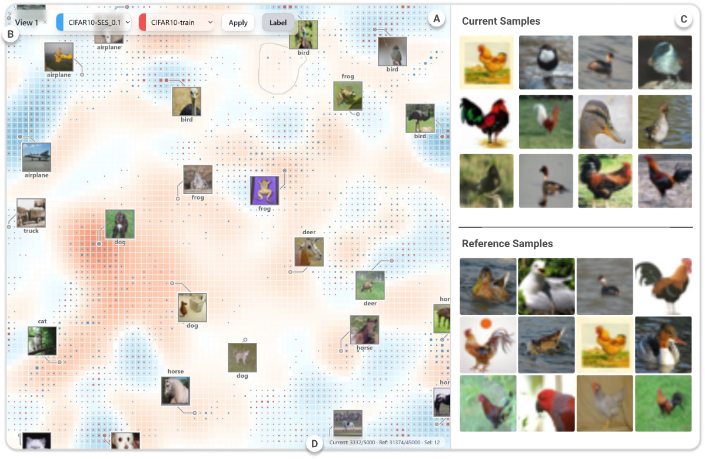

# DiffGrid

Code for [**Revealing the Gap: Visual Comparison of Large-Scale Datasets via Multi-Scale Density Difference Map**](https://dl.acm.org/doi/full/10.1145/3772318.3791171).

Xinyuan Guo, Xu Zhu, Yilin Ye, Shixia Liu · **CHI 2026** · [中文](README.zh-CN.md)



## Setup

Python 3.10/3.11, Node.js 22, and Vulkan 1.3 with a compatible driver. Tested on Linux.

```bash
git clone https://github.com/yczddgj/DiffGrid.git
cd DiffGrid
python3.10 -m venv .venv
source .venv/bin/activate
python -m pip install torch==2.6.0 torchvision==0.21.0 --index-url https://download.pytorch.org/whl/cpu
python -m pip install -r backend/requirements.txt -r backend/requirements-vulkan.txt
```

For GPU computation, install the corresponding CUDA build of PyTorch instead of the CPU build above.

## Run

Generate a small synthetic dataset and start the backend:

```bash
python scripts/prepare_demo.py
DIFFGRID_FEATURE_TYPE=demo DIFFGRID_GRID_RESOLUTION=32 python backend/app.py
```

Without Vulkan, add `DIFFGRID_REGULARIZATION=0` to the backend command to run with an unregularized layout.

Start the frontend in another terminal:

```bash
cd frontend
npm ci
npm run dev
```

Open `http://localhost:5173`, select **DiffGrid**, choose **Demo-current** and **Demo-reference**, then click **Apply**. The backend runs on `127.0.0.1:5000`.

## Data

Original datasets and model weights are not included. See [data preparation](docs/DATA.md) to use your own data and [experiment notes](docs/EXPERIMENTS.md) for scripts and configuration. Data are stored in `database/`; set `DIFFGRID_DATA_DIR` to use another directory.

## Citation

```bibtex
@inproceedings{guo2026revealing,
  title     = {Revealing the Gap: Visual Comparison of Large-Scale Datasets via Multi-Scale Density Difference Map},
  author    = {Guo, Xinyuan and Zhu, Xu and Ye, Yilin and Liu, Shixia},
  booktitle = {Proceedings of the CHI Conference on Human Factors in Computing Systems},
  pages     = {1--20},
  year      = {2026},
  doi       = {10.1145/3772318.3791171}
}
```

## License

[MIT](LICENSE). [Third-party licenses](THIRD_PARTY_NOTICES.md).
