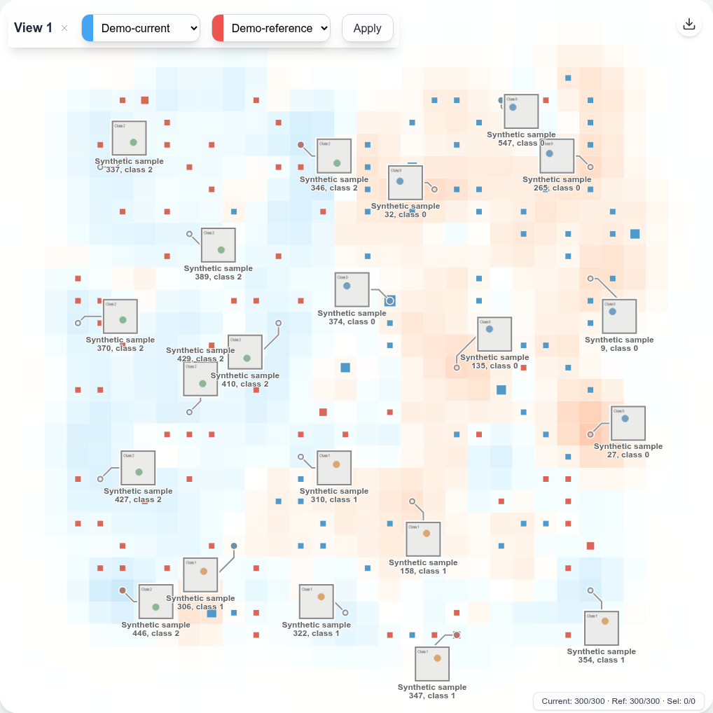

# DiffGrid

Research code for **Revealing the Gap: Visual Comparison of Large-Scale Datasets via Multi-Scale Density Difference Map**.

**Xinyuan Guo, Xu Zhu, Yilin Ye, and Shixia Liu** · **CHI 2026**

[Paper (ACM)](https://dl.acm.org/doi/full/10.1145/3772318.3791171) · [DOI](https://doi.org/10.1145/3772318.3791171) · [中文说明](README.zh-CN.md)

DiffGrid is an interactive visual analysis system for comparing dataset distributions. It combines a regularized two-dimensional layout with density difference maps at multiple scales, helping users explore both overall distribution changes and local differences. Linked scatterplots, sample previews, and lasso selection connect distribution patterns to individual samples.



*The regularized DiffGrid interface displaying the synthetic demo at a reduced grid resolution.*

The implementation includes a Vue 3 / TypeScript / D3 frontend, a Flask / PyTorch backend, UMAP and PCA projections, KDE and least-squares density difference (LSDD) baselines, and data preparation utilities for image, tabular, and text data.

## Quick start

Use **Python 3.10 or 3.11** and **Node.js 22 LTS**. Linux is the tested platform. The full regularized layout needs **Vulkan 1.3**, a compatible driver, and the Python Vulkan bindings. CUDA is optional for density computation; the small example below also works on a CPU.

### 1. Install the backend

From the repository root:

```bash
git clone https://github.com/yczddgj/DiffGrid.git
cd DiffGrid
python3.10 -m venv .venv
source .venv/bin/activate

# CPU build. For a CUDA build, install the matching PyTorch 2.6 / torchvision 0.21 wheels instead.
python -m pip install torch==2.6.0 torchvision==0.21.0 --index-url https://download.pytorch.org/whl/cpu
python -m pip install -r backend/requirements.txt
```

An optional Conda environment definition is provided in `backend/environment.yml`. Install image feature extractors only if needed:

```bash
python -m pip install -r backend/requirements-features.txt
```

Precomputed features and the synthetic demo do not require DreamSim, CLIP, or pretrained model downloads.

### 2. Generate example data and start Flask

```bash
python scripts/prepare_demo.py
```

This creates two synthetic slices, `Demo-current` and `Demo-reference`, with 300 samples each, images, labels, and eight-dimensional features. The example illustrates a change in class proportions; it is separate from the paper's evaluation datasets.

For the **full regularized layout**, install a Vulkan 1.3 loader and compatible driver, then run:

```bash
python -m pip install -r backend/requirements-vulkan.txt
DIFFGRID_FEATURE_TYPE=demo DIFFGRID_GRID_RESOLUTION=32 python backend/app.py
```

See the [upstream regularizer installation instructions](https://github.com/hennesrave/regularization-python#installation-ubuntu-2204-lts) for platform setup. CUDA availability alone does not guarantee that Vulkan is installed.

For a **CPU introduction without Vulkan**, explicitly disable layout regularization:

```bash
DIFFGRID_FEATURE_TYPE=demo DIFFGRID_REGULARIZATION=0 DIFFGRID_GRID_RESOLUTION=32 python backend/app.py
```

This option uses the projected layout directly, so its spatial layout differs from the regularized DiffGrid method in the paper. The density difference map and interactions remain available. The default research grid resolution is 400; the commands above use a smaller grid for the demo.

Flask listens on `http://127.0.0.1:5000`. The commands use POSIX shell syntax; on PowerShell, set environment variables with `$env:NAME="value"` before starting Python.

### 3. Start the frontend

In another terminal:

```bash
cd frontend
npm ci
npm run dev
```

Open the URL printed by Vite (usually `http://localhost:5173`). Select **DiffGrid**, choose **Demo-current** as the current slice and **Demo-reference** as the reference slice. The first UMAP projection may take longer because Numba compiles its kernels.

Zoom and pan to inspect local differences, and draw a lasso to inspect selected samples. KDE and LSDD modes provide comparison views without layout regularization.

## Your own data

The backend uses a global index, dataset blocks, and named slices of integer sample IDs. All data paths are relative to the configured data directory; no original research data or model weights are bundled.

See [Data preparation](docs/DATA.md) for the file format and a runnable registration example using precomputed features, and [Experiments](docs/EXPERIMENTS.md) for the available evaluation scripts and their limits.

## Configuration

Backend options are read from the environment in [`backend/config.py`](backend/config.py). Relative data/model directories resolve from the repository root, so the server can be started from any working directory.

| Variable | Default | Purpose |
| --- | --- | --- |
| `DIFFGRID_DATA_DIR` | `database` | Dataset files, indices, slices, caches, and results |
| `DIFFGRID_MODEL_DIR` | `backend/models` | Local model directory for optional annotation utilities |
| `DIFFGRID_HOST` | `127.0.0.1` | Flask bind address |
| `DIFFGRID_PORT` | `5000` | Flask port |
| `DIFFGRID_FEATURE_TYPE` | `dreamsim` | Feature key in each block; use `demo` for the example |
| `DIFFGRID_N_NEIGHBORS` | `100` | UMAP neighborhood size |
| `DIFFGRID_REGULARIZATION` | `1` | Set to `0` to explicitly disable Vulkan layout regularization |
| `DIFFGRID_GRID_RESOLUTION` | `400` | Heatmap grid resolution; try `32` for a CPU demo |

The frontend proxies `/api` and `/static` to Flask. To change the backend port, copy `frontend/.env.example` to `frontend/.env.local` and update `DIFFGRID_PROXY_TARGET`; set `DIFFGRID_PORT` to the same port for Flask. For a separately hosted frontend, set `VITE_API_BASE_URL` and configure static dataset image routing to the backend.

```bash
cd frontend
npm run build
npm run preview
```

The backend maintains shared in-memory view state. Run one backend process per analysis session; a multiworker deployment needs additional state management. The Flask development server is intended for local research use.

## Repository layout

```text
backend/
  app.py                       Flask API
  heatmap_calculator.py         Density maps, KDE, and LSDD
  view_manager.py               Views, sampling, and interactions
  image_placement_optimizer.py  Sample preview placement
  datatools/                   Indices, slices, feature extraction, projection
  deepcore/                    Bundled coreset/training dependencies
frontend/                      Vue 3 / TypeScript / D3 interface
scripts/prepare_demo.py         Synthetic example data generator
experiments/                   Additional density comparison script
docs/                          Data format and experiment notes
tests/                         Portable backend and numerical smoke tests
```

Datasets, pretrained weights, feature caches, machine-specific environment exports, logs, and participant records are excluded. Historical coreset/training utilities are included for research, but the UI's coreset-selection endpoint is a placeholder and returns HTTP 501. The main supported workflow is interactive dataset comparison.

## Validation

```bash
python -m unittest discover -s tests -v
cd frontend
npm ci
npm run build
```

The automated backend checks use synthetic data and PCA at a small grid resolution. They do not download model weights or reproduce the paper's full experiments. See [experiment notes](docs/EXPERIMENTS.md) for the Vulkan check and reproducibility scope.

## Citation

```bibtex
@inproceedings{guo2026revealing,
  author    = {Xinyuan Guo and Xu Zhu and Yilin Ye and Shixia Liu},
  title     = {Revealing the Gap: Visual Comparison of Large-Scale Datasets via Multi-Scale Density Difference Map},
  booktitle = {Proceedings of the 2026 CHI Conference on Human Factors in Computing Systems},
  year      = {2026},
  pages     = {1--20},
  publisher = {Association for Computing Machinery},
  doi       = {10.1145/3772318.3791171},
  url       = {https://doi.org/10.1145/3772318.3791171}
}
```

## License and acknowledgments

DiffGrid code is released under the [MIT License](LICENSE). Bundled third-party components retain their original licenses; see [THIRD_PARTY_NOTICES.md](THIRD_PARTY_NOTICES.md). In particular, the layout regularizer builds on Hennes Rave et al.'s [De-cluttering Scatterplots with Integral Images](https://doi.org/10.1109/TVCG.2024.3381453), and the coreset/training utilities use [DeepCore](https://github.com/PatrickZH/DeepCore). External datasets and model weights remain subject to their respective terms.
